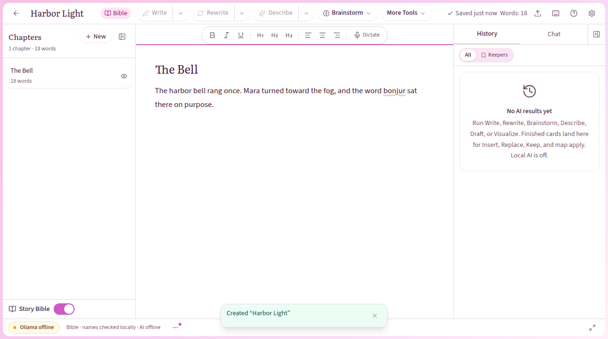
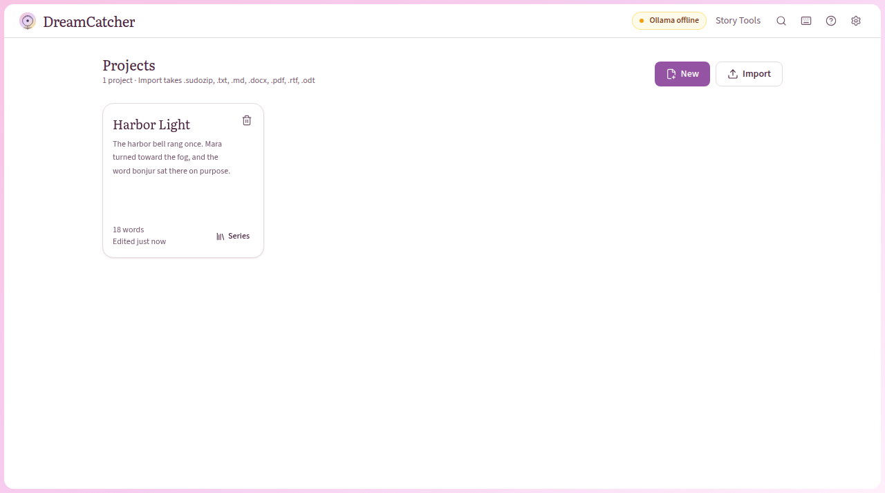
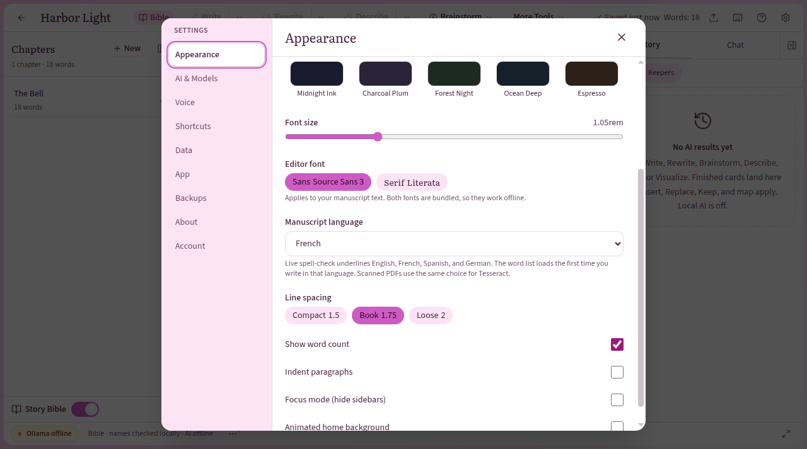

# DreamCatcher

A writing app for Linux. Chapters, the Story Bible, and backups stay on your computer. Optional help with prose uses a local [Ollama](https://ollama.com) model. You do not need an account.

This repository holds release downloads only. The source code is private.



## Download (v0.2.0)

| File | Use it when | SHA-256 |
| --- | --- | --- |
| [DreamCatcher_0.2.0_amd64.AppImage](https://github.com/MontarxDev/DreamCatcher-releases/releases/download/v0.2.0/DreamCatcher_0.2.0_amd64.AppImage) | You want one file you can run without installing | `8b84f0d41edda9c968ccd1d67646017a1c05fb50d22887a5b4744b2125c56547` |
| [DreamCatcher_0.2.0_amd64.deb](https://github.com/MontarxDev/DreamCatcher-releases/releases/download/v0.2.0/DreamCatcher_0.2.0_amd64.deb) | You want a menu entry on Linux Mint or Ubuntu | `fedc6b611e6df06ffaa5ede555a1e44ca0c68fdf498fa43965cbc0eda56dfce8` |

- Checksums: [SHA256SUMS](https://github.com/MontarxDev/DreamCatcher-releases/releases/download/v0.2.0/SHA256SUMS) · signature [SHA256SUMS.minisig](https://github.com/MontarxDev/DreamCatcher-releases/releases/download/v0.2.0/SHA256SUMS.minisig)
- File signatures: [AppImage.minisig](https://github.com/MontarxDev/DreamCatcher-releases/releases/download/v0.2.0/DreamCatcher_0.2.0_amd64.AppImage.minisig), [deb.minisig](https://github.com/MontarxDev/DreamCatcher-releases/releases/download/v0.2.0/DreamCatcher_0.2.0_amd64.deb.minisig) · public key: [minisign.pub](minisign.pub)
- All releases: [releases page](https://github.com/MontarxDev/DreamCatcher-releases/releases)

Both builds are 64-bit (amd64). DreamCatcher does not ship macOS or Windows builds.

## Install

### AppImage

```bash
chmod +x DreamCatcher_0.2.0_amd64.AppImage
./DreamCatcher_0.2.0_amd64.AppImage
```

If it does not start, install FUSE and try again:

```bash
sudo apt update
sudo apt install libfuse2t64
```

On older Ubuntu releases the package is `libfuse2`.

### .deb (Linux Mint / Ubuntu)

```bash
sudo apt install ./DreamCatcher_0.2.0_amd64.deb
```

Open **DreamCatcher** from the application menu. Your projects live in `~/.local/share/DreamCatcher/` and stay there if you remove the package.

## Verify your download

Every release file is signed with the DreamCatcher release key ([minisign.pub](minisign.pub)):

```
RWTTrK4Sb8jW9O8sAYqUL8TRqlE3W41qXqdESN9Kmh3xl78Pk43GvPk5
```

Install minisign (`sudo apt install minisign`). Download the file you want, plus `SHA256SUMS`, `SHA256SUMS.minisig`, and that file's `.minisig`, into one folder. Then run:

```bash
# 1. Check the checksum list is genuine
minisign -Vm SHA256SUMS -P RWTTrK4Sb8jW9O8sAYqUL8TRqlE3W41qXqdESN9Kmh3xl78Pk43GvPk5

# 2. Check your download matches it
sha256sum -c SHA256SUMS --ignore-missing

# 3. (Optional) Check the file's own signature (AppImage or .deb)
minisign -Vm DreamCatcher_0.2.0_amd64.AppImage -P RWTTrK4Sb8jW9O8sAYqUL8TRqlE3W41qXqdESN9Kmh3xl78Pk43GvPk5
minisign -Vm DreamCatcher_0.2.0_amd64.deb -P RWTTrK4Sb8jW9O8sAYqUL8TRqlE3W41qXqdESN9Kmh3xl78Pk43GvPk5
```

Each command should print `Signature and comment signature verified` or `OK`. If any check fails, don't run the file.

## First hour

1. **New** on the home screen. Name the project. The editor opens on the first chapter.
2. Add chapters from **New** in the left sidebar, or **Ctrl+Shift+N**.
3. Open **Story Bible** for characters, places, and plot (**Ctrl+B**).
4. For local prose help, install Ollama from **Settings → AI & Models**, then pull a model. To use Gemma 4 12B:

   ```bash
   ollama pull gemma4:12b
   ```

   Set **Default Ollama model** to `gemma4:12b`. In the Story Bible, open **Match My Style**, add a sample of your prose, and turn the profile on. In **Write**, turn on **Use my style**. Suggestions wait in History until you apply them.

5. Export from **Ctrl+K**: `.sudozip` for the whole project, or `.docx`, `.pdf`, `.md`, `.txt`, or `.epub` for the chapters. API keys are never included.
6. **Settings → Backups** for automatic `.dcbackup` copies and restore.



In v0.2.0, live spell-check underlines **English**. A red wavy line marks a misspelling. Right-click for suggestions.

A scanned PDF needs the Tesseract program (`sudo apt install tesseract-ocr`). In v0.2.0, scanned PDFs are read as English; the English language data downloads once on first use if it is not already installed.

**Coming in the next release:** French, Spanish, and German spell-check and scanned-PDF languages, chosen under **Settings → Appearance → Manuscript language**. They are not in the v0.2.0 download.



## Privacy

Writing, the Story Bible, spell-check, and backups run locally. In the default Local mode, your manuscript is not sent to a service.

Internet calls in the app, and only in these cases:

- **Update check**, off until you use Settings → App → Check for updates (or turn on Check weekly): `GET https://github.com/MontarxDev/DreamCatcher-releases/releases/latest/download/latest.json`. Nothing is downloaded or installed.
- **Ollama on this computer:** `http://127.0.0.1:11434` (`/api/tags`, `/api/chat`, `/api/pull`).
- **Ollama install**, if you click Install: the official Linux tarball from `https://ollama.com/download/ollama-linux-amd64.tar.zst` (or arm64) and the checksum at `https://github.com/ollama/ollama/releases/latest/download/sha256sum.txt`.
- **Models you choose to download:** Whisper from `https://huggingface.co/Xenova/whisper-tiny.en`, `whisper-base.en`, or `whisper-small.en`; optional Vosk from `https://alphacephei.com/vosk/models/vosk-model-small-en-us-0.15.zip` and `https://github.com/alphacep/vosk-api/releases/download/v0.3.45/vosk-linux-x86_64-0.3.45.zip`.
- **Scanned-PDF language data**, the first time it is missing: `https://github.com/tesseract-ocr/tessdata_fast/raw/4.1.0/eng.traineddata`.
- **Cloud providers**, only after you save a key and select that provider: `api.x.ai`, `api.openai.com`, `api.anthropic.com`, `generativelanguage.googleapis.com`, or a custom base URL you enter. Picture URLs returned by an image provider are fetched once and stored locally.

Keys stay in the system keyring (or a private `secrets.json` if the keyring is unavailable). They are not part of exports or backups.

## Spell-check dictionaries

v0.2.0 bundles the offline English Hunspell word list (`dictionary-en`, MIT AND BSD). French (`dictionary-fr`, MPL-2.0), Spanish (`dictionary-es`, GPL-3.0 OR LGPL-3.0 OR MPL-1.1), and German (`dictionary-de` / igerman98, GPL-2.0 OR GPL-3.0) are coming in the next release.

## License

Proprietary. All rights reserved. See [LICENSE](LICENSE).
